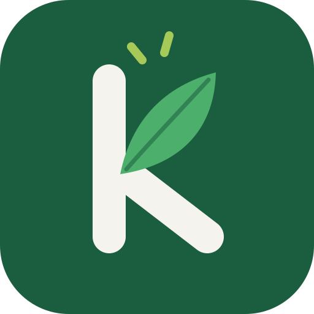

<p align="center">
  
</p>

# Kvar

**Kvar** («lo que queda», en sueco) controla el stock de víveres e insumos de la casa, arma la lista de compras sola
y, más adelante, sugiere qué cocinar con lo que hay. Es una PWA para instalar en el iPhone, pensada para usarse con
una mano y con el menor esfuerzo posible.

- 📄 Especificación completa y fases: [`docs/SPEC.md`](docs/SPEC.md)
- ✅ Estado: **Fase 1** (auth, hogar compartido, estados, lista automática, tiempo real, offline) y **Fase 2**
  (códigos de barras con Open Food Facts, foto del producto recortada sin fondo)
- 📱 Versión web (PWA) y app de iPhone para el App Store, con el mismo código y la misma base
- 🔑 Sin correos ni contraseñas: se entra con «Empezar» y el hogar se comparte con un código

---

## Requisitos

- Node.js 22 o más nuevo (`node -v`; lo pide Capacitor 8 para la app de iPhone). Instalalo desde nodejs.org (LTS)
- Una cuenta de [Supabase](https://supabase.com) (el plan gratis alcanza)
- Opcional: Postgres 15+ local para correr la prueba de RLS (`npm run test:db`)

## Instalación local

```bash
git clone <este-repo> kvar && cd kvar
npm install
cp .env.example .env      # completá las dos variables VITE_ (ver abajo)
npm run dev               # http://localhost:5173
```

Para probar desde el iPhone en la misma red: `npm run dev -- --host` y abrí la IP de tu compu. El modo offline y la
instalación requieren HTTPS, así que para eso usá el despliegue (o `npm run build && npm run preview -- --host` detrás
de un túnel HTTPS).

## Configuración de Supabase

### 1. Crear el proyecto
En [app.supabase.com](https://app.supabase.com) → **New project**. Anotá la contraseña de la base.

### 2. Variables del cliente
**Project Settings → API**: copiá **Project URL** y la clave **anon public** en `.env`:

```env
VITE_SUPABASE_URL=https://abcd1234.supabase.co
VITE_SUPABASE_ANON_KEY=eyJhbGciOi...
```

La anon key es pública por diseño: lo que protege los datos es Row Level Security. **Nunca** pongas la
`service_role` key ni claves de IA en variables `VITE_`.

### 3. Crear el esquema
Opción A — **SQL Editor** (lo más simple): pegá y ejecutá, **en este orden**, el contenido de cada archivo de
`supabase/migrations/`:
1. [`20261015000000_initial_schema.sql`](supabase/migrations/20261015000000_initial_schema.sql)
2. [`20261016000000_fase2_codigos_y_fotos.sql`](supabase/migrations/20261016000000_fase2_codigos_y_fotos.sql)

Cuando aparezcan migraciones nuevas (fases siguientes), se corre solo la nueva.

Opción B — **Supabase CLI**:

```bash
npx supabase init          # si te pregunta, no sobrescribas supabase/migrations
npx supabase login
npx supabase link --project-ref <tu-ref>
npx supabase db push
```

Corré **todas** las migraciones de `supabase/migrations/` en orden (con la CLI, `db push` lo hace solo).

La migración inicial crea todas las tablas (incluidas las de fases futuras), las políticas RLS, las funciones
(`create_household`, `join_household`, `set_product_status`, `purchase_list_item`, …) y agrega las tablas a la
publicación de **Realtime**. Para verificarlo: **Database → Publications → supabase_realtime** debe listar
`products`, `shopping_list_items`, `locations`, `categories`, `households` y `household_members`.

Las fotos de productos van al bucket privado **product-images**, que crean las migraciones (Storage → Buckets). Cada
hogar solo puede leer y escribir su carpeta.

### 4. Ingreso sin correo (un interruptor)
Kvar entra **sin correo ni contraseña**: al tocar «Empezar», Supabase crea un usuario propio de ese teléfono. Lo que
se comparte es el **hogar**, con su código de invitación.

- **Authentication → Sign In / Providers** → activá **Allow anonymous sign-ins** → **Save**.

Nada más: no hace falta configurar correos.

Cosas a saber:
- Si alguien borra la app o cierra sesión, vuelve con «Empezar» y se suma de nuevo con el código del hogar
  (Ajustes → Hogar). Los productos y la lista no se pierden mientras quede alguien en el hogar.
- La seguridad no cambia: cada usuario, con o sin correo, solo ve los hogares a los que se unió.

#### Opcional: entrar con correo
La pantalla de ingreso también tiene «Entrar con mi correo» (código de 6 dígitos). Para usarlo, Supabase exige un
servidor de correo propio (SMTP) antes de dejar cambiar las plantillas:
1. **Authentication → Emails → SMTP Settings**: por ejemplo con Gmail (`smtp.gmail.com`, puerto `465`, tu dirección
   y una *contraseña de aplicación* de Google).
2. **Emails → Magic link or OTP** y **Confirm sign up** → **Source**: el cuerpo tiene que incluir `{{ .Token }}`:

   ```html
   <h2>Kvar</h2>
   <p>Tu código para entrar:</p>
   <p style="font-size:32px;letter-spacing:8px"><strong>{{ .Token }}</strong></p>
   ```

### 5. (Fases 2+) Secretos de Edge Functions
Las llamadas a IA, Open Food Facts y push se hacen solo desde Edge Functions. Los secretos se cargan en Supabase, no
en el cliente:

```bash
npx supabase secrets set AI_PROVIDER=anthropic AI_MODEL=<modelo> AI_API_KEY=<clave>
npx supabase secrets set VAPID_PUBLIC_KEY=... VAPID_PRIVATE_KEY=... VAPID_SUBJECT=mailto:vos@ejemplo.com
```

`AI_PROVIDER` admite `anthropic`, `openai` o `gemini`. En la Fase 1 no hace falta nada de esto.

## Despliegue

Es un sitio estático (`npm run build` → `dist/`). Cualquier hosting con HTTPS sirve; hay que redirigir todas las rutas
a `index.html`.

**Vercel** (incluye `vercel.json`):
1. Importá el repo. Framework: *Vite*. Build: `npm run build`. Output: `dist`.
2. Agregá `VITE_SUPABASE_URL` y `VITE_SUPABASE_ANON_KEY` en *Environment Variables*.
3. Poné la URL final en **Site URL** de Supabase.

**Netlify / Cloudflare Pages** (incluye `public/_redirects`): build `npm run build`, directorio `dist`, mismas
variables.

### Instalar en el iPhone
1. Abrí la URL en **Safari**.
2. **Compartir** → **Agregar a inicio**.
3. Abrí Kvar desde el ícono: arranca en modo standalone, sin barra de Safari, y funciona sin conexión.

Para compartir el hogar: **Ajustes → Invitar** manda un link `https://tu-dominio/unirse/CODIGO`; la otra persona entra
con su correo y queda en el mismo hogar. También puede escribir el código a mano.

## App de iPhone (App Store)

La app de iPhone es esta misma app empaquetada con [Capacitor](https://capacitorjs.com): mismo código y misma base
que la versión web. El proyecto de Xcode está en `ios/` y usa Swift Package Manager (no hace falta CocoaPods).

### Requisitos
- Una Mac con Xcode al día (Apple exige compilar con una versión reciente para subir al App Store) y la cuenta de Apple Developer.
- El `.env` completo (las variables `VITE_` quedan dentro de la app al compilar). Completá también `VITE_PUBLIC_URL`
  con la dirección de la versión web: los links de invitación que se comparten desde el iPhone apuntan ahí.

### Antes de la primera subida
1. **Elegí el identificador de la app** (por ejemplo `uy.tunombre.kvar`) y cambialo en `capacitor.config.ts` (`appId`)
   y en Xcode (*Signing & Capabilities → Bundle Identifier*). Una vez registrado en App Store Connect no se cambia.
2. En Xcode: *Signing & Capabilities → Team* = tu equipo de Apple Developer.
3. En [App Store Connect](https://appstoreconnect.apple.com): *Apps → +* con ese identificador.
4. Vas a necesitar una **política de privacidad** con URL pública (Apple la pide). Kvar guarda: correo, productos,
   lista y el historial de cambios del hogar, en Supabase.

### Probar en tu iPhone
```bash
npm run ios          # build web + sincroniza ios/ + abre Xcode
```
En Xcode elegí tu iPhone conectado y tocá ▶︎.

### Subir a TestFlight / App Store
```bash
npm run ios:release  # igual que ios, pero sube el número de build
```
En Xcode: *Product → Archive* → *Distribute App* → *App Store Connect*. A los minutos aparece en TestFlight; desde ahí
se invita a la otra persona del hogar o se manda a revisión.

La versión visible (por ejemplo 0.1.0) sale de `package.json` (`"version"`); cambiala ahí antes de cada versión nueva.

### Actualizaciones y compatibilidad
Las personas actualizan la app del App Store en momentos distintos, así que la base tiene que seguir funcionando con
versiones viejas:
- En las migraciones, **solo agregar** (tablas, columnas con valor por defecto, funciones). No renombrar ni borrar lo
  que use una versión publicada.
- Si un cambio rompe compatibilidad, subí la versión mínima y las apps viejas muestran «Actualizá Kvar»:
  ```sql
  update app_config set value = '0.3.0' where key = 'min_client_version';
  ```

### Ícono y pantalla de arranque
`npm run icons` genera también el ícono de iOS (1024 px, sin transparencia, como exige Apple) y la pantalla de
arranque, a partir de `public/brand/`.

## Demo sin servidor

`npm run build:demo` arma una versión de prueba que funciona sola, sin Supabase ni cuentas: un hogar de ejemplo,
cambios guardados en el navegador, «Sofía marca algo» para simular a otro miembro y códigos de barras de ejemplo en
lugar de la cámara. Sale en `dist-demo/kvar-demo.html` (más los dos videos de bienvenida) y se puede publicar como
página estática.

## Scripts

| Comando | Qué hace |
|---|---|
| `npm run dev` | Servidor de desarrollo |
| `npm run build` | Typecheck + build de producción con service worker |
| `npm run preview` | Sirve el build (para probar offline/PWA) |
| `npm test` | Tests unitarios (estados, lista de compras, equivalencias, operaciones offline) |
| `npm run test:db` | Levanta un Postgres efímero, aplica la migración y prueba RLS y la lógica SQL |
| `npm run icons` | Regenera los íconos de la PWA y de iOS desde `public/brand/*.svg` |
| `npm run build:demo` | Demo autocontenida con datos de ejemplo (`dist-demo/`) |
| `npm run ios` | Build + sincroniza el proyecto de Xcode + lo abre |
| `npm run ios:release` | Lo mismo, subiendo el número de build para TestFlight |

`npm run test:db` necesita los binarios de Postgres (`initdb`, `pg_ctl`, `psql`); usa un stub mínimo del esquema `auth`
de Supabase. Ver `supabase/tests/`.

### Logo e íconos
Los SVG de `public/brand/` son una versión vectorial del logo. Si tenés el ícono original en alta resolución, guardalo
como `public/brand/kvar-icon.png` (cuadrado, 1024 px) y corré `npm run icons`: los PNG de la PWA se generan desde ese
archivo. La pantalla de ingreso usa `public/brand/kvar-mark.svg`.

## Estructura

```
src/
  domain/        lógica pura y testeada: estados, lista, equivalencias, operaciones offline
  lib/           Supabase, IndexedDB, tema, utilidades
  store/         estado + motor de sincronización (cola offline, Realtime), acciones, avisos
  components/    UI reutilizable (filas deslizables, hojas inferiores, barra de pestañas…)
  screens/       Inicio, Productos, Lista, Qué cocino, Ajustes, ingreso
supabase/
  migrations/    esquema completo con RLS
  tests/         prueba de RLS y de la lógica SQL
ios/             proyecto de Xcode (Capacitor)
docs/SPEC.md     especificación del producto por fases
```

## Cómo funciona el modo offline

Cada acción (cambiar estado, comprar, agregar) se aplica al instante sobre los datos guardados en el teléfono y se
encola en IndexedDB. Al volver la conexión, la cola se envía en orden, se vuelven a leer los datos del hogar y recién
ahí se vacía la cola. Cada cambio de estado lleva un id generado en el teléfono, así que reintentar no duplica nada; si
otro miembro hizo un cambio más nuevo mientras estabas offline, el tuyo queda en el historial pero no lo pisa.
